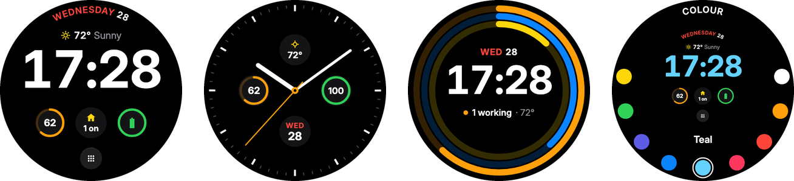
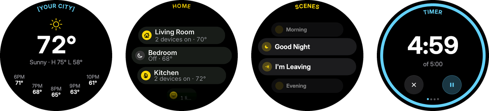
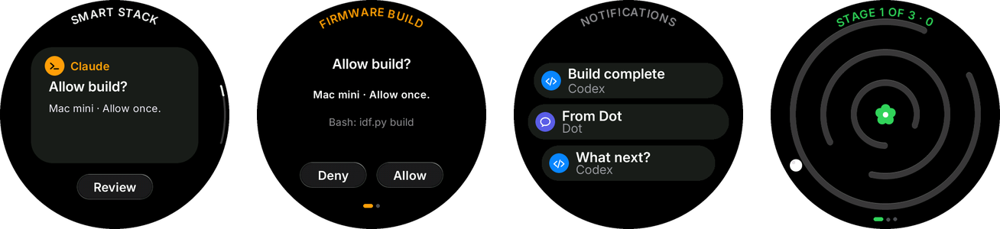
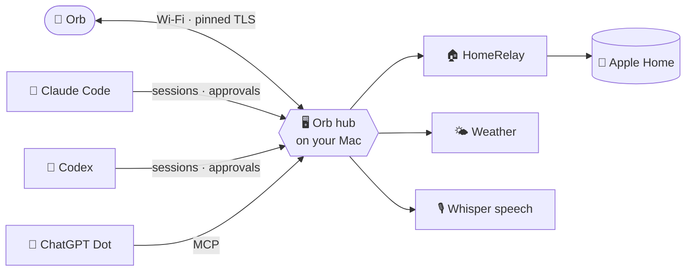

<div align="center">

# 🔮 Orb

**A tiny round computer for your desk that runs your home and keeps an eye on your AI agents.**

Clock faces, Apple Home, weather, timers, tilt-to-play games, and a tap-to-approve card when Claude or Codex needs your permission, all on a 1.75″ round AMOLED that fits in your palm.

[](LICENSE)


[Tour](#-a-quick-tour) · [Apps](#-whats-on-it) · [How it connects](#-how-it-connects) · [Try it](#-try-it-in-30-seconds) · [Build & flash](docs/building.md)

</div>

---

## 👀 A quick tour

<p align="center">
  
</p>

**⌚ Faces.** True black, made for a circle, with glass-like controls. A digital face with weather, battery and Home complications, the analog Meridian, activity rings, and your pick of colour.

<p align="center">
  
</p>

**🏠 Around the house.** The weather for the next few hours, your Apple Home rooms and scenes ("Good Night", "I'm Leaving"), and timers.

<p align="center">
  
</p>

**🤖 Agents and play.** When Claude wants to run a build, Orb shows an **Allow / Deny** card. Codex and ChatGPT's Dot send notifications. And when you need a break, tilt to play.

<sub>Faces, weather, scenes and timer are frames from the [design system](docs/design/); Home rooms, agents, notifications and Marble are renders of the real firmware UI from the desktop emulator.</sub>

## 📱 What's on it

| App | What it does |
| --- | --- |
| ⌚ **Faces** | Digital, analog and activity-ring faces with weather, battery and Home complications. Always On when you set it down. |
| 🏠 **Home** | Your Apple Home rooms, accessories and scenes, through [HomeRelay](https://github.com/shhish/HomeRelay). Tap a room, flip a light, run a scene. |
| 🌤️ **Weather** | Now, high and low, and the next few hours. |
| ⏱️ **Time** | Timers, alarms and reminders. |
| 🤖 **Agents** | Your Claude Code and Codex sessions on a Smart Stack: who's busy, who's waiting, and Allow / Deny right on the device. |
| 🔔 **Notifications** | From Claude, Codex and ChatGPT's Dot, with replies where the agent supports them. |
| 🎙️ **Voice** | Hold and talk. Speech is transcribed on your Mac with Whisper, never in the cloud, and you confirm before anything is sent. |
| 🎮 **Play** | Five offline games you play by tilting: **Marble**, **Snake**, **Orbit**, **Pop**, and **Beads**, a pile of 256 beads that settles into the time. |
| ⚙️ **Settings** | Display, sound, battery, units, Bold Text and Reduce Motion. |

## ✨ The little things

- 🫧 **Made for a circle.** Every screen is laid out for the round display, following Apple's design guidelines, with controls that look like glass.
- 🔋 **Lasts.** Light sleep, an Always On face and a calm mode keep a small battery going.
- 🔐 **Locked down.** A pinned-TLS link to your Mac, firmware updates that are signed and roll back if they fail, and Wi-Fi set up privately over Bluetooth.
- 📲 **Updates itself** over the air from your Mac.
- 🧪 **Runs on your laptop too.** The real firmware UI runs in a desktop window, tilt included (arrow keys or Shift-drag).

## 🧩 How it connects



The **hub** ([`hub/`](hub/README.md)) is a small Python service on a Mac that's always on. It pairs Orbs, signs and serves firmware updates, transcribes speech, and connects agent sessions and ChatGPT's Dot. Apple Home goes through [HomeRelay](https://github.com/shhish/HomeRelay), which keeps its credentials on the Mac. [Switchboard](https://github.com/shhish/switchboard) can send cards to Orb too.

## 🚀 Try it in 30 seconds

No board needed. With CMake, Ninja and SDL2 (`brew install cmake ninja sdl2`):

```bash
make emu
```

The real firmware UI opens in a window. The mouse is your finger, the arrow keys tilt the device, `m` toggles Reduce Motion and `s` saves a screenshot.

## 🔧 The hardware

Orb runs on the **Waveshare ESP32-S3-Touch-AMOLED-1.75C**:

| | |
| --- | --- |
| 🧠 Chip | ESP32-S3, 8 MB PSRAM, 32 MB flash |
| 🖼️ Screen | 1.75″ round AMOLED, 466 × 466, capacitive touch |
| 🎙️ Audio | Microphones and a speaker |
| 🧭 Sensors | Motion sensor (tilt games, and it wakes when you pick it up) |
| 🔋 Power | Battery with charging and power management |

To build the firmware, flash a board, run the hub or work on the code, see **[Building, flashing and developing](docs/building.md)**. For the inside story: [architecture](docs/design.md) · [device protocol](docs/protocol.md) · [design guidelines](docs/hig.md) · [agents](docs/agents.md) · [ChatGPT Dot](docs/dot.md).

## 📄 License

Orb's own code is [MIT](LICENSE), Copyright (c) 2026 shhish. Dependencies and fonts keep their own licenses; see [THIRD_PARTY_NOTICES.md](THIRD_PARTY_NOTICES.md), including the Espressif-product restriction in `esp_new_jpeg`.
