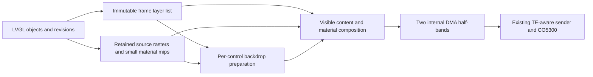

# Orb rendering architecture: retain content, separate materials, stream bands

Architecture study, 2026-10-27. Source reviewed at `95e4d03` on `orb/w2-speed`.
Stages 0 and 1 have default-off implementations. The render pacing round adds a
separate default-off stage 4 scheduler for measurement; stages 2, 3 and 5 remain
the accepted rollout plan. Scheduling does not establish their compute headroom.
No board or live service state was changed by this
implementation. Numbers labelled **measured** come from the supplied board
reports; **model** and **gate** remain unmeasured engineering budgets. Host
validation does not establish new device performance.

## Decision

Keep LVGL for the object tree, layout, input, typography, accessibility settings,
and cold rasterization. Add a bounded **retained band compositor** for Orb's
content and floating controls. Keep source row rasters and their continuous
1/256-scale transforms. Prepare glass backdrops independently of the output
band, retain unchanged material results, and stream RGB565 through two halves
of the existing internal DMA arena. Use TE-paced **30 Hz scrolling** and target
**60 Hz small-control animation and cached navigation slides**. At the observed
16.8 ms panel period these mean about 29.76 and 59.52 updates/s.

Do not build a full-resolution multiscale atlas for every row, replace LVGL,
enable direct PSRAM display DMA, or make hardware scrolling a dependency.
The proposed material sampler changes pixels and requires design review;
there is no claim of an exact cache optimization for that part of the design.
Keep the current renderer as the reference and bounded fallback during rollout.

The architectural change is the separation of **content identity, presentation
state, material dependencies, and output-buffer ownership**. It removes repeated
work on unchanged content and the dependency of glass on a partly rendered
band. It does not conjure a GPU or remove the cost of continuously scaling text.

## What the evidence actually establishes

The required inputs are [design.md](design.md), [HIG §2 and §6](hig.md),
[PERFORMANCE.md](PERFORMANCE.md),
[round 1](agent-briefs/wave2/speed-round1-results.md),
[round 2](agent-briefs/wave2/speed-round2-results.md),
[round 3 profile](agent-briefs/wave2/speed-round3-results.md),
[round 3 implementation plan](agent-briefs/wave2/speed-round3-plan.md),
[round 4](agent-briefs/wave2/speed-round4-results.md), and the
[study brief](agent-briefs/wave2/arch-study.md). HANDOFF, protocol, Dot and physical
UX feedback supply the integration and visual constraints. Repository `file:line`
references below are relative to the repository root at the reviewed revision.

| Evidence | Consequence |
| --- | --- |
| Round 4 control: scroll 19.6 fps, DRAW 37.6 ms, render-to-final-DMA frame 49.5 ms; glass 40.1 fps, DRAW 15.4 ms. | Current scrolling is compute-bound with serial output transfer. |
| Round 3: source raster builds **0**, retained source rasters **565,232 B**. | Moving rows are already cached; repeated glyph and widget rasterization is not the recurring bottleneck. |
| Round 3 scroll: transformed-image task elapsed sum 15.37 ms/frame; BLUR task sum 21.12 ms/frame. | Transform/composition and backdrop work are the two substantial recurring costs. These worker wall times overlap and include preemption; they are not additive serial stages. |
| Round 3: 147 cache hits + 306 misses = 453 real material operations for 151 frames. | Three actual control blurs per frame, not eight. Empty padded dispatches are not five extra kernels to eliminate. |
| Round 2 image scratch: 2,189 internal allocations, no PSRAM fallback, 3,806 B peak; throughput unchanged. | Scratch placement was tested and did not explain the 40 ms draw. |
| Round 2 adaptive arena: half=2, full=1,425. | The existing small-invalidation overlap experiment does not overlap full-screen scrolling. |
| Round 4 scale LRU: 3 hits, 158 misses/builds, 151 evictions; scroll fell to 16.4 fps despite DRAW falling to 24.1 ms. | Moving preparation before DRAW is not a speedup. An expanded on-demand exact-scale LRU is the wrong animation policy. |
| Round 4 without the LRU: 19.9 fps / 36.7 ms DRAW; glass 41.3 fps / 14.7 ms. | Further local loop/quality patches have a small measured return. |

Round 1 A–G ran through automatic OTA and are not architecture baselines. The
settled controls and rounds 2–4 are usable. Historical 51–58 fps renderer-only
figures preceded smooth blur, curved scaling and the integrated memory budget.
They do not demonstrate that today's scene can reach those rates by restoring
one setting. Direct PSRAM display DMA failed on this board at both 40 and
80 MHz; host tests cannot overturn those transfer failures. [PERFORMANCE.md](PERFORMANCE.md)

### Current execution path

1. LVGL joins invalidations and prepares outdated source rasters **before**
   display RENDER_START (`firmware/third_party/lvgl__lvgl/src/core/lv_refr.c:428`).
   Row rasters are explicitly prepared before the demo animation
   (`firmware/components/orb_demo/orb_demo.c:291`).
2. The matte row source survives motion. Scale and opacity are presentation
   properties (`firmware/third_party/lvgl__lvgl/src/core/lv_obj_raster.c:187`).
   `row_scale()` and `fade_edges()` change them with viewport position
   (`firmware/components/orb_demo/orb_demo.c:123`, `:138`).
3. Non-native scale still dispatches a transformed image. The software path
   creates RGB565+A8 tiles, resamples, then blends them into the internal band
   (`firmware/third_party/lvgl__lvgl/src/core/lv_obj_raster.c:297`;
   `firmware/third_party/lvgl__lvgl/src/draw/sw/lv_draw_sw_img.c:508`, `:568`).
4. Glass reads the content already drawn into that band. It averages source
   cells, filters them, reconstructs, tints, applies rounded coverage and dithers
   to RGB565 (`firmware/third_party/lvgl__lvgl/src/draw/sw/lv_draw_sw_blur.c:50`).
   SDF shadow/edge and relit rim follow
   (`firmware/components/orb_ui/orb_glass.c:174`).
5. A single 78,288 B internal band is queued and cannot be overwritten until
   actual SPI results drain. TE waits are per band, not a frame-rate governor
   (`firmware/components/orb_display/orb_display.c:187`, `:210`, `:349`, `:649`).

The opaque unmasked copy and fill paths already use S3 SIMD
(`firmware/components/orb_lv_simd/src/orb_lv_blend.c:20`, `:37`). A faded,
scaled, or masked image is not automatically that fast path. The assembly has
alignment-dependent branches; it is not a general affine texture sampler
(`firmware/components/orb_lv_simd/src/lv_rgb565_blend_normal_to_rgb565_esp32s3.S:43`).

## Testing the study's hypotheses

### Retention: correct direction, incorrect diagnosis

LVGL is a retained object system, and Orb has already added persistent raster
content. The [fork ledger](../firmware/third_party/lvgl__lvgl/ORB_PATCHES.md)
describes the invalidation, matte, opacity and scale rules. The missing retention
is chiefly **derived presentation and material state**, not source widgets.

Apple's useful lesson is to retain bitmaps and change presentation properties.
Its other advantage is hardware compositing, which this S3 does not have.
Apple explicitly describes that division in
[Core Animation Basics](https://developer.apple.com/library/archive/documentation/Cocoa/Conceptual/CoreAnimation_guide/CoreAnimationBasics/CoreAnimationBasics.html).
`shouldRasterize` also still applies scaling filters when a cached bitmap is
scaled; caching does not make that operation free.
[CALayer.shouldRasterize](https://developer.apple.com/documentation/quartzcore/calayer/shouldrasterize)

### Translation and pre-blur: only for an invariant translated plane

For a spatially invariant linear blur B, translation T, and adequate common
boundary support, `B(T(C)) = T(B(C))`. This justifies pre-blurring a static
wallpaper or a frozen content plane moving rigidly. It does **not** justify
translating one pre-blurred screenshot of Orb's curved list:

- Each row changes scale and opacity as its centre moves through the viewport.
  Screen-fixed scroll-edge fades, clipping and independent parallax also change
  the composite. The new frame is not `T(old_frame)`.
- Scaling a pre-blurred row changes its effective blur radius. Blur, an
  overlapping-layer composite, clipping and opacity rounding cannot be reordered
  arbitrarily. RGB565 quantization is nonlinear.
- Today's blur samples the clipped control rectangle, replicates its boundary
  pixels, and places its reduced sampling grid at that rectangle. It has no
  HIG-style 16 px halo. Its filter is a four-direction IIR, not the three box
  passes suggested as starting values in HIG §2.2
  (`firmware/third_party/lvgl__lvgl/src/draw/sw/lv_draw_sw_blur.c:54`, `:126`, `:151`).
- Final Bayer dither is screen-anchored. Translating already dithered pixels is
  not byte-equivalent to reconstructing and dithering at the destination
  (`firmware/third_party/lvgl__lvgl/src/draw/sw/lv_draw_sw_blur.c:325`).

Therefore retain **untinted filtered material maps**, and recompute them when
their actual input presentation changes. For moving lists, compose a reduced
backdrop from the current layer list each frame. At rest, relighting must reuse
the existing material without re-sampling rows or comparing source bytes.
Rigid pre-blur translation is an optional specialization with proven invariants,
not the list algorithm. Re-blurring only on settle would freeze the wrong text
under the glass during a drag and is rejected.

### Fixed scale levels: wrong memory/quality trade for full-resolution text

For a representative 332×84 RGB565 row, sum
`2 * ceil(332*s/256) * ceil(84*s/256)` over the following Q8 scales. These are
payload-only calculations, excluding AA edges, stride and allocator overhead:

| Prebuilt scales from 128 through 256 | Bytes/row | Bytes for ten rows |
| --- | ---: | ---: |
| Step 8: 17 levels | 559,970 | 5,599,700 |
| Step 4: 33 levels | 1,085,498 | 10,854,980 |
| Step 1: 129 exact levels | 4,239,354 | 42,393,540 |

Even the 17-level set exceeds the approximately 3.6 MB free PSRAM before any
material or transition storage. Four rows of it require 2.24 MB plus source
rasters; continually preparing the next row must then survive direction changes
and arbitrary scrolling. That moves a substantial cold-build problem instead
of eliminating it. AX3 rows can be larger, so these are not worst-case bounds.

Nearest selection at step 8 can move a row edge about 2.6 px; step 16 about
5.2 px. Flooring doubles those worst errors. Cross-fading different-size text
rasters without resampling gives doubled contours, not an intermediate geometric
scale. A residual continuous transform restores the expensive sampler. Keep
continuous visible-content transforms. Use small box-averaged source mip levels
only for the already blurred material input, where they serve anti-aliasing,
not discrete visible text sizes.

## Recommended compositor



### Content and frame ownership

Introduce a small Orb compositor component rather than embedding a second
widget toolkit inside LVGL. LVGL remains the only owner of objects and layout.
An adapter publishes an immutable frame list containing source handle/revision,
source format/stride, z-order, bounds, clip, continuous scale, opacity, translation
and accessibility/material epoch. Start with the existing demo's matte rows,
heading and three controls; unsupported objects use the existing LVGL path.

Composition-only moves preserve source identity. Text, style, font, size, theme,
Dynamic Type or Bold changes invalidate the source and all derived material
dependencies. Destruction retires a handle only after all frame users release
it. Sources cannot be evicted or mutated while a queued draw references them.
Preserve the existing ancestor invalidation rules and explicit PSRAM allocator
(`firmware/third_party/lvgl__lvgl/ORB_PATCHES.md:28`;
`firmware/components/orb_display/orb_display.c:617`).

Use one list for visible composition and material sampling. A separate
approximation of scroll position, fade, clipping or parallax would let the glass
show a different row from the one beneath it. Black-matte rasters are valid only
over their declared black content plane; do not reuse them as transparent images
over arbitrary screens.

### Prepare material input before emitting output bands

For each visible glass control, compute its current sample rectangle, including
the maximum needed press geometry and a defined halo. Use the HIG's 16 px halo
as the new material contract, with explicit screen-edge treatment. Include a
future lens-displacement footprint in that support. Keep maps per control;
blurring one global screen would change the present independent boundary rules.
The halo itself is a deliberate visual change, not an exactness repair.

Compose that rectangle directly at **one-third resolution**, from the current
underlying content layers. Use RGB888 filtering, area-prefiltered source mips
(half, quarter and eighth dimensions), and bilinear sampling with a recorded
grid origin. Preserve current continuous transforms and fades in this sampling
calculation. Never select isolated source pixels as a substitute for an area
average: that aliases moving glyphs into streaks. Do not add another factor-four
motion mode as the source of the expected speedup; round 4 already limits that
idea's demonstrated value.

The structural saving is avoiding full-resolution backdrop capture, byte
comparison and reduction on every control update. Reduced composition from mips
is **not byte-identical** to averaging the already transformed, rounded and
RGB565-quantized full-resolution output. Test it as a new material, with the
existing full-resolution path as the visual reference. Keep the current IIR
filter initially to isolate the sampling change; HIG §2.2 labels its numerical
filter recipe as a starting point to tune.

Filter into an untinted RGB888 map before output-band drawing. Keep the
full-resolution original-content patch needed for AA boundary mixing, or draw
that content normally into the destination before applying coverage. Retain a
cached RGB565 material base for an unchanged presentation. Apply tint, rounded
AA, reconstruction and screen-anchored dither when its material parameters
change; rim and labels remain separate.

Cache validity is a dependency proof. The **filtered-map key** contains source
generations **and all intersecting lower-layer transforms/opacity/clips/order**,
sample bounds, grid/halo/filter, theme and accessibility inputs that affect that
map. It excludes tint, rim/light and final output dither phase. The separate
**material-base key** adds tint, coverage geometry, output format and destination
dither phase. A tint tick invalidates the final base, not its untinted filtering.
A move that changes sampled content still invalidates the map. Unmanaged drawing
or an incomplete dependency list uses the exact fallback; a bare object ID or
frame number is never sufficient.

The existing four press sizes cache SDF geometry, not every final material
state. Tint changes continuously during swell
(`firmware/components/orb_ui/orb_glass.c:107`, `:199`, `:224`, `:283`). Retain an
untinted map per admitted geometry and recompute cheap material composition as
needed. Do not pretend four final tinted bitmaps cover the spring.
The blur rectangle also follows independently changing style transform sizes
(`firmware/third_party/lvgl__lvgl/src/core/lv_obj.c:1630`); four SDF mask sizes
do not bound all sampled rectangles. Admit actual sample bounds or sample a
proven common larger support with explicit reconstruction rules.

| Trigger | Work that should run |
| --- | --- |
| Light changes, content and control geometry fixed | Restore cached material base; draw changed rim and label regions. No row transform, source recapture or blur. |
| Press/tint changes | Update geometry/tint/AA; reuse valid untinted maps or prepare the new bounds. Restore old and new control/shadow bounds. |
| Scroll or parallax changes | Use the new frame list; regenerate affected reduced backdrops and visible transformed content. |
| Text/state/font/layout changes | Rebuild only affected source rasters and their mips; invalidate intersecting material dependencies. |
| Quiet screen | No display job. A genuine clock/status update dirties only its bounds and dependent glass. |

Reduce Transparency follows its own admitted material parameters. A fully opaque
surface can omit backdrop sampling; a 90% surface still depends on the remaining
10% of backdrop. If enlarged blur support exceeds the material budget, use the
compatibility renderer rather than silently making that surface opaque.

Current code implements blur, tint and SDF edge/shadow/rim, but not HIG §2.2's
full lens-displacement or adaptive luminance/variance model. There is no existing
lensing implementation to claim we preserved. Reserve the map sampling seam
for it; adding it must have its own cost and visual acceptance. Never trade
true backdrop dependence, AA or dithering for a painted sheen. The mandatory
AGENTS/design-gate prohibition on **all gradients and glows** overrides the
historical touch-glow suggestion in HIG §2.2.

### Output and transfer

Initially keep the full 84-row internal band while validating prepared
materials. Once no material reads the live destination band, use the existing
arena as two **39,144 B usable halves**, 39,168 B apart: **78,336 B total**, only
48 B more than today's band. This is capacity equivalent to 42 full-width rows
per half; round clipping can admit more rows near the poles.

The current half-buffer selector only admits complete small invalidations
(`firmware/components/orb_display/orb_display.c:371`, `:401`). It must become a
full-animation output mode after removing the backdrop dependency. The
whole-control guard can then be removed from this compositor path
(`firmware/components/orb_ui/orb_glass.c:307`), while the old renderer retains it.
Do not simply enable the present half-buffer switch and expect scroll overlap.

Use two explicit states per buffer: writable/rendering, then queued/in-flight,
then writable only after the SPI fence. Never change the aliased arena layout
with outstanding jobs. Keep bounded backpressure, actual final-band completion,
failed-frame accounting, PM lock ownership and full redraw after transfer errors
(`firmware/components/orb_display/orb_display.c:210`, `:252`, `:349`;
`firmware/components/orb_board/board_ws175c.c:153`, `:274`). The ISR callback alone
does not return buffer ownership.

Hot output composition remains in internal SRAM. PSRAM holds sequentially read
sources and cold/settled retained images; snapshots are populated by copying
completed internal bands, not by random full-screen PSRAM painting. Keep
RGB565_SWAPPED output. RGB888 costs 50% more wire traffic and memory with no
established visual need; RGB332 or an indexed framebuffer would sacrifice
typography and dark-material quality and require expansion to panel pixels.

### Dirty regions, transitions and pacing

LVGL already has partial invalidation. Add dependency-aware damage, not a second
unrelated dirty-rectangle system. Union old and new presentation bounds, include
shadow/lens/filter support, then propagate damage into intersecting glass. Erase
exposed pixels to black before compositing. Preserve the raster cover-search
repair (`firmware/third_party/lvgl__lvgl/src/core/lv_refr.c:484`); source children
cannot claim coverage on behalf of a faded or shrunk raster root.

For scrolling, most visible content changes; expect substantial screen traffic.
Exposed-strip-only updates are not the software algorithm. Dirty regions chiefly
help idle, status changes, presses and rim animation. Merge rectangles when
extra pixel cost is less than another window's command/TE cost. Measure that
threshold, and retain even-aligned panel windows and the six-column X offset.

For navigation slides, retain two immutable RGB565 screen snapshots and compose
their translated, clipped spans into internal output bands. Build/copy snapshots
on entry or in bounded preparation slices and report their cost; do not hide
it before RENDER_START. Reuse existing LVGL snapshot/cold drawing facilities
where appropriate, but route large captures through internal bands. A snapshot
does not include a hardware overlay: glass baked into it moves with that screen.
If chrome must remain screen-fixed, split it from content and account for live
material work; do not apply the cheap two-snapshot budget to that case.

Do not freeze consequential state through a transition. An approval, disconnect
or other material update cancels/rebuilds the transition or applies at the next
safe frame. Coalesce ordinary status updates. A navigation slide does not replace
the HIG's zoom-from-icon launch or glass materialization/morph rules; those
remain distinct effect classes with separate budgets. Reduce Motion uses the
specified 150 ms cross-fade and frozen IMU light, with a 30 Hz blend budget.

Use measured TE period T, not an independent 16 ms repeating timer. Scroll
presentation targets every second TE; small glass and admitted cached slides
target every TE. Keep the existing per-band scan avoidance: launching all bands
at a TE edge does not itself prevent tearing. Preflight a frame against its
deadline, render just in time, and skip an expired presentation slot without
queuing stale frames. Advance motion from monotonic elapsed time, keeping HIG
§6's 240 Hz spring substeps and velocity on retarget. Input is sampled promptly
even when rendering is capped. Lock the cadence for an animation; if a 60 Hz
effect cannot meet admission, choose 30 Hz at its start rather than free-running
between 40 and 60 fps. No active animation means no TE-driven redraw loop.

## Panel capabilities and the hardware-scroll verdict

Chipone's preliminary
[CO5300 V0.00 datasheet](https://dl.espressif.com/AE/esp-iot-solution/CO5300_Datasheet_V0.00.pdf),
pp. 122–123, omits `0x33/0x37`: scrolling is **undocumented**, not proven
impossible. Relevant details are on pp. 164–167/179, 172, 28 and 107.

| Capability | Evidence and architectural use |
| --- | --- |
| Addressed writes | `0x2A/0x2B/0x2C`; already implemented in `firmware/components/orb_board/board_ws175c.c:274`. |
| Partial display | `0x12/0x13`, row/column ranges `0x30/0x31`; region selection, not pixel translation. |
| GRAM readback | `0x2E/0x3E`; return packing/dummy behaviour unclear. Orb has no receive path. |
| Axis changes | `0x36`: MY/MX/RGB; MV undocumented. |

There is a driver disagreement: local Espressif `panel_co5300_swap_xy()` sets
MV anyway (`firmware/managed_components/espressif__esp_lcd_co5300/esp_lcd_co5300_spi.c:353`).
[Arduino_GFX's CO5300 implementation](https://raw.githubusercontent.com/moononournation/Arduino_GFX/master/src/display/Arduino_CO5300.cpp)
explicitly implements flips instead of true rotation. Neither an API name nor
another controller's DCS command definitions prove CO5300 capability. The
[Waveshare board documentation](https://docs.waveshare.com/ESP32-S3-Touch-AMOLED-1.75C)
confirms the exact S3R8/466×466/QSPI hardware;
[Muse's same-board source](https://raw.githubusercontent.com/facebookincubator/muse-gadget-sdk/main/esp32/components/muse/boards/board_waveshare_s3_175c.c)
corroborates the gap and ordinary band transport. An inspected LilyGO
T-Encoder-Pro GFX example uses SH8601; it is not CO5300 scroll evidence.

Even successful hardware scroll would move **one flattened GRAM plane**. Fixed
top and bottom areas cannot preserve floating circles/capsules overlapping the
scrolling region. Their old composited pixels would move with the content.
Viewport-dependent row scaling and screen-fixed fades require changing existing
rows, not just newly exposed strips. Hardware scroll could help a future plain
terminal; it does not implement this product's list.

At 80 MHz, four data lines carry at most 40 MB/s: a square RGB565 frame is
434,312 B and has a **10.86 ms ideal pixel-only lower bound**. Orb's approximately
10.8 ms measured transfer is for clipped bands, including its transport costs,
not evidence of a 434 KB square sent with zero overhead. Published minima are
20 ns writes/100 ns reads; RGB888/666/555 QSPI is capped at 50 MHz. Guaranteed
80 MHz RGB565 operation is not established. Retain the empirically working board setting without
raising it; S3 GP-SPI itself tops out at 80 MHz in this mode.
[ESP32-S3 datasheet, SPI2](https://documentation.espressif.com/esp32_s3_datasheet_en.pdf)

The ideal visible disk is about 341 KB, 21.5% smaller than the square. Current
`orb_geom_band()` uses the widest chord of each rectangular band, not a different
window for every scanline (`firmware/components/orb_display/orb_display_geom.c:18`).
Some invisible pixels remain inside those rectangles. Smaller bands reduce that
waste but increase windows and TE scheduling. Budget from actual sent bytes;
do not claim an additional 21% gain or assume all corners are already skipped.

### One-hour lead-only capability probe

This is a future temporary diagnostic fixture, **not an operation performed by
this study**. It is independent of implementing the recommended compositor and
earns no performance credit. One owner holds the existing exclusive lease on
the development board; the second board is never used. Preserve the trusted
signed image, NVS, assets and pairing. Use synthetic numbered colour bands and
a checkerboard, low brightness, no personal content, no vendor-page sweeps,
gamma/power/OTP writes or persistent settings. Pause rendering and drain SPI
before every diagnostic mode change. Provide a timed reset/reinitialization
escape before attempting commands.

| Minutes | Self-contained test and expected observation |
| --- | --- |
| 0–10 | Record installed identity and normal TE; retain the exact recovery image and current brightness/MADCTL/format. Prepare synthetic frame and recovery timer. |
| 10–20 | Use existing writes on central even-aligned rectangles, including the X gap. Only those pixels should change. Photograph the panel and record TX bytes. |
| 20–30 | On normal command page 0, set `0x30 {00,80,01,7F}`, enter `0x12`, then restore `0x13` and full redraw. Expected: display of the selected row region, not movement of GRAM. Stop/reinitialize on any unexpected state. |
| 30–45 | If receive wiring/turnaround is verified, begin at 1 MHz: opcode `0x03`, 24-bit address `{00,cmd,00}`, SIO0 return. Read `0x04/0x0B/0x0C`, then a tiny known patch with `0x2E`. Establish ambiguous packing/dummy behaviour empirically against that pattern. All-zero/all-FF without a working known-register read is inconclusive. |
| 45–60 | Exit partial mode; reset/reinitialize and redraw. Restore the original signed app if a diagnostic image was installed. Verify normal brightness, panel, exact firmware identity, Wi-Fi and paired hello. Abort further tests after an SPI error. |

If the lead specifically wants an empirical test of the **undocumented generic
DCS candidates**, it can replace the readback portion: page 0, `0x33
{00,00,01,D2,00,00}` (0+466+0), then `0x37 {00,01}` and `{00,10}`, observing
whether the numbered image moves without pixel writes. Restore `{00,00}` and
reset/reinitialize regardless of outcome. These are generic DCS formats, not
documented CO5300 commands; actual internal GRAM geometry may differ. This
optional experiment is excluded from the default documented-command probe.
`lcd_command()` accepts at most four data bytes
(`firmware/components/orb_board/board_ws175c.c:210`): a six-byte definition needs
a dedicated bounded diagnostic transaction with correct lifetime, **not two
separate commands/CS cycles**. A negative result means unsupported in the tested
mode; a positive result still fails the curved-list/floating-control test above.

Use a photo/video or direct observation for all GRAM-mode tests. Orb's screenshot
shows software-rendered pixels and cannot prove that the panel internally moved
or masked them. Even ideal single-line 10 MHz readback takes hundreds of
milliseconds for a full frame; do not plan per-frame read/modify/write.

## Frame-budget model

`DRAW` excludes important preparation. Whole-phase FPS is completed frames divided
by actual phase seconds; it is not necessarily `1000/frame_ms`.
`firmware/components/orb_devtools/orb_devtools.c:346` reports those separate
denominators. Round 4 B is the concrete warning: 35.6 ms measured frame latency
but 16.4 fps, approximately 61 ms per completion including outside-window work.

Use this end-to-end model:

```text
frame work = scene/preparation + output composition + wire - measured overlap
             + non-overlapped scheduling/TE cost
presentation interval = admitted integer number of measured TE periods
```

With band ping-pong, overlap is a pipeline schedule, not `max(total draw,total
wire)` for free: first-band fill, last-band drain, unequal band costs, command
setup and TE holds remain. Keep per-band start/end timestamps to measure it.

| Scene | Current board evidence | Proposed steady-state model, ms per update | Presentation target |
| --- | --- | --- | --- |
| Scroll, curved list + 3 glass controls | Round 4: DRAW 37.6; latency 49.5; phase interval ≈51.0. Earlier settled controls: wire ≈10.8. Per-task blur/transform sums above are overlapping attribution. | Scene 1.0 + reduced backdrop prep 3.0 + output draw 20.0 + wire 11.5 − overlap 9.5 + other/TE 1.5 = **27.5**. Draw allocation: ≤15.5 continuous row transform, ≤4.5 copies/material reconstruction/AA/rim. | Every 2T: ≈33.6 ms, leaving ≈6.1 ms model headroom. **30 Hz class**, not a 45/60 fps promise. |
| Glass light/press, content fixed | Round 4: DRAW 15.4, phase interval ≈24.9. Earlier wire ≈2.8; other timing not separately resolved for round 4. | Scene 0.5 + valid-map preparation 0.3 + output 4.0 + wire 3.0 − overlap 1.0 + other/TE 1.0 = **7.8**. No row resampling or repeated blur on light-only frames. | Every T: ≈16.8 ms. Press geometry misses must also meet this gate after warming admitted states. |
| Navigation slide, two cached flattened screens | No current board benchmark. Do not invent a baseline. | Scene 0.5 + output copies/clip 5.0 + wire 11.5 − overlap 4.0 + other/TE 1.5 = **14.5**. Snapshot preparation excluded here and separately capped/reported below. | Target every T if admitted; otherwise fixed 2T for that transition. |
| Reduce Motion cross-fade | No current board benchmark. | Scene 0.5 + full-screen two-source blend 12.0 + wire 11.5 − overlap 8.0 + other/TE 1.5 = **17.5**. Model only; masked/transparent sources can cost more. | Every 2T for the 150 ms fade. |
| Quiet idle | Accepted integration already suppresses idle redraws except real status/clock changes. | **0 display preparation, draw, wire and frame jobs** between genuine changes. Event service/IMU sampling is not zero CPU. | Event-driven; no animation timer wakes to draw. |

The proposed allocations are falsifiable targets, not measurements or additive
savings inferred from the task profile. In particular, **3 ms reduced backdrop
prep is the highest-risk assumption**. If that alone costs 10 ms, the 30 Hz model
fails; stop and revise rather than hiding it before DRAW. Keep the measured
visible-row transform as a substantial cost in the budget. Direct PSRAM DMA,
hardware scroll, clock increases and new SIMD scaling supply **zero** assumed
savings. An OTA flash interval is a separate degraded workload, not a promise
of these animation rates.

## Memory budget and admission

The measured free heap is a starting condition, not an allocation guarantee.
The approximately 50 KB internal and 3.6 MB PSRAM figures refer to integrated
workloads. Heap capability views overlap; never add internal and DMA free bytes.
Do not reduce BLE, TLS, stacks, font fallbacks or future audio to fund graphics.

| Storage | Location | Budget and ownership |
| --- | --- | --- |
| Output arena | Internal DMA | **78,336 B total** replacing 78,288 B; two usable 39,144 B halves. No second full buffer. |
| Compositor synchronization/state | Internal | **≤2 KiB new persistent** total; reuse the sender/UI tasks, no new large worker stack. Large tables/registries go in PSRAM. |
| Temporary draw work | Internal first / PSRAM fallback | Adopt the existing **optional** bounded allocator: **16 KiB maximum concurrent charge**, not a permanently allocated pool. Its current default-off switches do not cap every allocation today. New preparation must explicitly use declared charges or run sequentially. |
| Source rasters | PSRAM | Existing benchmark **565,232 B**; impose a **768 KiB** admitted working-set cap for the initial screen. Larger/AX3 screens virtualize off-screen rows or use the generic fallback. |
| Material source mips | PSRAM | **320 KiB cap**, including metadata/stride. Half/quarter/eighth RGB888 payload for ten 332×84 rows is roughly 275 KB; build only on source revision. |
| Per-control raw patches, filtered maps, material bases | PSRAM | **192 KiB combined cap** for the initial three-control surface, with explicit geometry admission. Two 72² circles + 196×72 capsule have 48,960 B RGB565 raw payload; halos/press sizes/maps/base copies are additional. Do not retain unbounded copies for every size/tint. |
| Scene list, damage/dependencies and profiler staging | PSRAM | **64 KiB cap** including metadata. Profiler snapshots are transient and must share this accounting. |
| Cold build/capture workspace | PSRAM | **256 KiB peak cap**, not one allocation per frame. Avoid a simultaneous full-screen ARGB8888 temporary (868,624 B). |
| Transition snapshots | PSRAM, temporary | Tight RGB565 payload **868,624 B** for two screens. Budget **896 KiB** including 944 B aligned row stride (879,808 B pair) and metadata. A retained settled snapshot counts as one of the two, not a third image. |
| Legacy exact blur fallback | PSRAM | Existing **192 KiB** payload cap while both paths coexist. A compositor frame uses one material backend; do not populate duplicate caches unnecessarily. |
| Exact-scale LRU | PSRAM | **0 B** in the recommended animation path. Disable rather than enlarge the 512 KiB experiment. |

New PSRAM caps sum to **1,769,472 B** (mips + materials + metadata + workspace +
two snapshots). From 3.6 MB measured free this leaves approximately 1.8 MB,
before future font/network/audio demands and any growth of the existing source
working set. The existing 565 KB sources and current blur cache are already
charged in that free-heap snapshot; do not subtract them twice. Future release
measurements must replace this arithmetic with actual free/largest/peak values.

Require **≥24 KiB internal free in each relevant capability view and ≥8 KiB
largest contiguous internal-DMA block**, through the measured combined workload,
not merely before an allocation. New persistent internal overhead plus the 48 B
arena growth must stay under 2.1 KiB. Reserve a **1 MiB PSRAM operating margin**
after optional surfaces are admitted, releasing snapshots/mips first if necessary.
Future audio's **5,760 B internal sample buffers alone**, descriptors, codec state
and task stacks still need explicit admission. These margins are project gates,
not proof that all future voice/font/TLS workloads fit.

Preallocate bounded descriptors; no general LRU, per-frame allocation, PSRAM DMA
source, or blocking all-level atlas generation on an input event. Allocation
failure falls back to the existing scene renderer or a transition without a
snapshot effect, preserving content and input. Avoid partially publishing a
new revision after OOM. Free retired surfaces after frame/transfer users drain.

## Alternatives and why they lose

| Candidate | Assessment |
| --- | --- |
| **Recommended: LVGL semantics + retained material/band compositor** | Preserves working input/type/accessibility, fixes the actual backdrop/band dependency, needs only +48 B DMA storage, retains a bounded fallback and a credible 30 Hz scroll budget. |
| LVGL native transform layers alone | Temporary simple/transform layers still need drawing and software transformation. They do not automatically retain a static subtree between frames. Use the existing raster implementation instead of replacing it with a per-frame layer. [LVGL draw layers](https://lvgl.io/docs/open/9.3/details/main-modules/draw/draw_layers.html) |
| LVGL snapshots alone | Useful capture/storage API, not dependency tracking or a cheap affine sampler. Local snapshot allocation includes full ext-draw bounds; whole-screen capture can demand large buffers. Keep it as a cold producer with explicit memory ownership. `firmware/third_party/lvgl__lvgl/src/draw/snapshot/lv_snapshot.c:57`, `:89`; [snapshot documentation](https://lvgl.io/docs/open/9.3/details/auxiliary-modules/snapshot.html). |
| All-row fixed scale atlas / larger exact LRU | Atlas exceeds memory at acceptable geometric precision; LRU has already thrashed on the device. Small material mips have a different purpose and a bounded footprint. |
| Translate one pre-blurred list image / panel scroll | Invalid for viewport-dependent scales/fades and fixed floating controls. Panel commands are also undocumented for scroll. |
| Slint | Its software renderer supports partial and line-by-line output on MCUs, which is relevant to buffer sizing. It still runs on the CPU; no primary evidence shows Orb-quality live glass/scaling becomes cheaper. A rewrite discards working integration and moves the same sampling problem. [Slint renderers](https://docs.slint.dev/latest/docs/slint/guide/backends-and-renderers/backends_and_renderers/), [MCU rendering](https://docs.slint.dev/latest/docs/rust/slint/docs/mcu/). |
| NanoGUI / GPU vector stacks | NanoGUI targets OpenGL-family hardware, absent on S3. Software emulation adds cost. [NanoGUI primary repository](https://github.com/wjakob/nanogui). |
| Full custom UI toolkit | A small custom compositor is justified; recreating layout, focus/input, typography and accessibility is not. No measured reason to replace those layers. |
| PPA or DMA2D acceleration | S3 has neither a general GPU nor the P4 PPA scaling/blending engine. Enabling an LVGL PPA option cannot create hardware. [Espressif PPA](https://docs.espressif.com/projects/esp-idf/en/latest/esp32p4/api-reference/peripherals/ppa.html). |
| More S3 SIMD / second-core parallelism | Keep the copy/fill assembly. Consider a fused scale/blend kernel only after profiling the new path; no assumed speedup. Two draw workers already exist (`firmware/sdkconfig.defaults:39`). UI/SPI are on core 1; networking and unpinned workers contend on core 0 and shared PSRAM. A new pinned blur worker or parallel layers need measured CPU-runtime and bandwidth evidence, not a presumed 2× gain. |
| Higher QSPI/PSRAM clock, direct PSRAM DMA | 80 MHz GP-SPI ceiling; preliminary panel timing qualification; real PSRAM-DMA underflow at both tried clocks. Instructions/rodata already share PSRAM (`firmware/sdkconfig.defaults:14`). Keep current clocks and internal DMA. [IDF PSRAM transfer constraints](https://docs.espressif.com/projects/esp-idf/en/stable/esp32s3/api-reference/peripherals/spi_master.html#transactions-with-data-on-psram). |

Apple/watchOS techniques that transfer are cached opaque content, limited live
materials, shallow visible hierarchy, display-paced animation, prompt input,
and work only on change. Apple GPU render-server throughput and private watchOS
implementation details are not evidence for S3 timing. Opaque surfaces and
measurement are also explicit Apple recommendations.
[Core Animation performance guide](https://developer.apple.com/library/archive/documentation/Cocoa/Conceptual/CoreAnimation_guide/ImprovingAnimationPerformance/ImprovingAnimationPerformance.html)

## What stays and what is removed

Keep the font system and OTA-safe built-in fallback, LVGL semantic objects,
source raster invalidation/leases, decoder bypass, opaque SIMD, SDF shape masks,
screen-anchored dithering, AA edges, round/even window handling, TE scan avoidance,
off-UI touch reads, actual SPI drain/failure handling, balanced CPU_MAX locks,
revision-driven status delivery and IMU noise suppression. Preserve the cover
correctness fix and its partial/full redraw regression. Keep the fork ledger
accurate as responsibilities move.

After the replacement passes board and design gates, remove the on-demand exact
scale LRU from the Orb animation path and its winning-option assumptions; retain
the generic continuous transform for visible rows and unsupported objects. Remove
band-local blur/whole-control guard dependence only on the migrated path. Remove
the failed direct-PSRAM-DMA pipeline and ineffective experimental scratch/culling
switches from production after preserving their failure evidence and relevant
ownership/OOM tests. Do not remove the guards/null checks those experiments
revealed. The exact blur implementation/cache remains the compatibility backend
until all real screens have been admitted; it need not occupy the new fast path.

## Implementation sequence and board acceptance

Stages 0 and 1 and the stage 4 TE scheduler are implemented behind separate
default-off switches. Stages 2, 3 and 5 remain future work. Stage 4 is an A/B
candidate, with no new board acceptance claim; see
[render-round-results.md](agent-briefs/wave2/render-round-results.md).
Each gets a same-source control, ordinary and
profiling runs, and a rollback to the preceding accepted stage. Do not combine
unrelated memory, scheduler, quality and transport changes.
The numbers below remain **expected acceptance targets**, not new measured
device performance. A failed gate stops promotion; it does not become
a lower DRAW success story.

The [stage 0–1 implementation report](agent-briefs/wave2/render-stage01-results.md)
records host tests, exact-pixel comparisons, screenshots and remaining board gates.

### Measurement contract and exact invocation

Keep brightness, scene, radio state, fonts, compiler options and clocks constant.
Use the sole development-board lease, trusted signing setup and current dev-feed
version so automatic OTA cannot replace a candidate. Reused-version USB images
must never be published. Leave the owner's real configs, hub and launchd alone.

`speed_ab.py` checks exact firmware/ELF identity, 90 seconds continuously online,
no fresh OTA, three unchanged 16-second scroll/glass scenes, heap/top/power and a
separate screenshot. `--fixtures` adds the synthetic transition and 25-second
quiet runs without replacing those original scenes. Commands below are **lead
only**: they build and flash the sole development board using the existing
trusted signing key. `--bench-version` is required for every build/profile and
must match the current dev feed so automatic OTA cannot replace the experiment.
Never publish these reused-version USB images. Start each ordinary case with a
new directory; profile commands resume only with identical options.
The lead's transport daemon must run this revision's command validator before
using `--fixtures` (`bench_transition` / `bench_quiet`); this work does not restart
the owner's running daemon. Without `--fixtures`, the original benchmark remains
unchanged. Accounting allocation failure reports `active=0` and invalidates the
measurement receipt while leaving the renderer usable.

```bash
speed_python="${ORB_PYTHON:-python3}"
speed_feed_version='<current dev-feed version, verified by the lead>'
# Keep ORB_SIGNING_KEY pointed at the already trusted development key.

# Same-source control: both architecture switches off.
"$speed_python" scripts/speed_ab.py build "$PWD/work/arch/control" \
  --bench-version "$speed_feed_version"
"$speed_python" scripts/speed_ab.py flash "$PWD/work/arch/control"
"$speed_python" scripts/speed_ab.py measure "$PWD/work/arch/control" --fixtures
scripts/speed_profile.sh --bench-version "$speed_feed_version" --profile-only \
  --output "$PWD/work/arch/control-profile" --fixtures

# Stage 0: identical renderer, trustworthy accounting enabled.
"$speed_python" scripts/speed_ab.py build "$PWD/work/arch/stage0" \
  --bench-version "$speed_feed_version" \
  --compare-config "$PWD/work/arch/control/sdkconfig.h" \
  --enable ORB_DISPLAY_RENDER_ACCOUNTING
"$speed_python" scripts/speed_ab.py flash "$PWD/work/arch/stage0"
"$speed_python" scripts/speed_ab.py measure "$PWD/work/arch/stage0" --fixtures
scripts/speed_profile.sh --bench-version "$speed_feed_version" --profile-only \
  --output "$PWD/work/arch/stage0-profile" --fixtures \
  --enable ORB_DISPLAY_RENDER_ACCOUNTING

# Stages 0 + 1: exact retained material presentation plus accounting.
"$speed_python" scripts/speed_ab.py build "$PWD/work/arch/stage01" \
  --bench-version "$speed_feed_version" \
  --compare-config "$PWD/work/arch/control/sdkconfig.h" \
  --enable ORB_DISPLAY_RENDER_ACCOUNTING \
  --enable ORB_DISPLAY_RETAINED_MATERIAL
"$speed_python" scripts/speed_ab.py flash "$PWD/work/arch/stage01"
"$speed_python" scripts/speed_ab.py measure "$PWD/work/arch/stage01" --fixtures
scripts/speed_profile.sh --bench-version "$speed_feed_version" --profile-only \
  --output "$PWD/work/arch/stage01-profile" --fixtures \
  --enable ORB_DISPLAY_RENDER_ACCOUNTING \
  --enable ORB_DISPLAY_RETAINED_MATERIAL
```

Both implemented options are reset off by the ordinary and profile runners,
checked in the effective configuration, and captured in provenance receipts.
`ORB_DISPLAY_DRAW_PROFILE` is enabled only for the separate profiling runs.
`ORB_DISPLAY_REDUCED_BACKDROP`, `ORB_DISPLAY_COMPOSITOR_BANDS`,
and `ORB_DISPLAY_SCREEN_SNAPSHOTS` remain **proposed**
switches: add their Kconfig definitions, allowlists and provenance checks before
attempting those later-stage experiments. `ORB_DISPLAY_TE_PACING` now has
Kconfig, runner and host coverage; its incremental measurement commands and
unearned board gates are in the render-round report. Stage 1 retains the current full bands
and exact material sampling/filter/tint/coverage/dither math; it does not enable
the reduced sampler or half-band transport.

Do not compare a profiled candidate against an ordinary control for final FPS.
The opt-in transition/quiet fixtures establish the missing baseline; they do not
claim cached-screen transitions. TE scheduling requires its independent stage 4
switch and lead measurement. New counters are
deferred, bounded and captured in receipts, not printed in hot loops:
scene/cold preparation time, material prep, actual blur executions, source/mip
builds, scheduled/completed/dropped presentations, completion-interval histogram,
per-band draw/queue/DMA timestamps, bytes, largest heaps and allocation peaks.
Retain ordinary `DRAW`, WAIT, HOLD, WIRE and frame latency too. No unbounded
trace is required.

| Stage | Scope and experiment | Exact gate before promotion |
| --- | --- | --- |
| **0 — trustworthy accounting** | Same renderer; add whole-update/preparation and cadence counters, plus optional transition/quiet fixtures. Establish missing current transition timings. | Original control reproduces **19–20.5 fps scroll, 37–41 ms DRAW; 39–42 fps glass, 15–16 ms DRAW** in three settled runs. Instrumentation-only ordinary throughput regresses **≤2%** against the same-source control. Existing source builds stay **0** during warm scroll. New accounting exposes round-4-style pre-DRAW work rather than absorbing it into an unnamed gap. |
| **1 — retain material presentation** | Revision dependency list; cache untinted/map/material results for settled content. Light-only dirty controls must not traverse transformed rows. Keep full bands and existing exact material math for this stage. | Scroll **≥19 fps** and no >2% regression against stage 0. Glass **≥55 fps**, **DRAW ≤6 ms**; light-only frames have **0 row transforms, 0 blur kernels, 0 source recaptures** after warmup. Warm press geometry does not trigger source raster builds. Frozen output is **byte-identical to stage 0**, including continuous tint, every actual blur rectangle, clipping and dither phase; partial/full redraws agree. No retained growth after 20 benchmark cycles. If the exact stage cannot meet 55, explain the measured remainder before proceeding. |
| **2 — reduced backdrop preparation** | Add mips on content revision and per-control current-presentation sampling/filtering before output. Still full-band serial transfer, isolating compute/quality. | Scroll **≥27 fps uncapped**, **whole-update mean ≤37 ms**, **DRAW ≤22 ms**, **all pre-DRAW scene/material work ≤4 ms mean and ≤6 ms p95**. These component caps must also meet the whole-update gate. Glass remains **≥55 fps**. Warm scroll has **0 source/mip builds**, **0 full-resolution scale-LRU builds/evictions**. Three real material updates/frame while moving, none for unchanged backdrop. Material payload **≤192 KiB**, source mips **≤320 KiB**. Pass design evidence before transport changes. |
| **3 — full-animation half-band overlap** | Same pixels as stage 2; switch to two internal halves for every migrated frame, remove live-band blur dependency/guard. Retain current TE scan holds. | Scroll **≥32 fps uncapped**, whole-update mean **≤30 ms**, p95 **≤33.6 ms** at observed T; glass **≥55 fps**. Per-band timestamps demonstrate **≥8 ms/frame actual overlap** on scroll. Wire **≤12 ms/frame**, bytes **≤400,000/frame** in the fixed scene, no transfer errors/failed frames. Internal arena **78,336 B**, new persistent internal overhead **≤2.1 KiB**, margins as above. Stage-2/3 frozen-frame output is byte-identical. |
| **4 — TE cadence and idle** | Add deadline scheduling; scroll 2T, glass T. Keep input and springs time-based. | Completed warm-phase throughput within **±2% of 500/T fps** for scroll and **1000/T fps** for glass (T in ms), approximately **29.76/59.52 fps**. At least **99%** of scheduled presentations complete in their slot; completion-interval p95 within **1 ms** of 2T/T, excluding explicitly logged phase boundaries. Event-to-first-causally-changed-DMA-completion p95 **≤2T+4 ms** scroll and **≤T+4 ms** glass. Fixed synthetic quiet screen: **0 frames and 0 bytes over 25 s**; real Face allows only documented clock/status updates. PM display lock returns inactive. |
| **5 — cached transitions** | Add two-screen snapshot capture and slide fixture; Reduce Motion cross-fade. Run both cold-entry and warm cycles via the extended same harness. | Warm admitted slide: every T with the same **99%** slot gate and **≤15 ms mean work**; otherwise admit 2T at start and require **≤30 ms mean**. Cross-fade every 2T, **≤25 ms mean work**. Cold two-screen capture **≤100 ms elapsed total**, sliced **≤2 ms UI work per scheduling slice**. Immediate input feedback p95 **≤2T+4 ms**; separately, cold entry-to-first-transition-frame **≤100 ms+2T**, warm entry p95 **≤2T+4 ms**. Two snapshots **≤896 KiB**; no third hidden backing store. Cancellation/state update tests release every frame lease. |

Use measured T in the gates when it differs from 16.8 ms. Existing 4 ms frame
latency buckets cannot prove a ±1 ms completion cadence; the new completion
interval counters must do that. Input latency begins at the injected/read input
event and ends at a DMA completion containing a pixel changed by **that event**;
unrelated transfers cannot satisfy it. Report full-response-frame latency
separately, with p95 **≤4T+4 ms** for scroll and **≤2T+4 ms** for glass, since
immutable frame preparation and scanning can span another interval. These are
software/transport response metrics, not optical photon latency.
If stage 3 cannot create headroom for stage 4,
keep the previous accepted renderer and revise the budget. Do not ship a 30 Hz
cap to conceal a 27 fps workload. If stage 5's 60 Hz admission fails, its defined
30 Hz mode is the supported outcome, recorded explicitly in the results.

After each stage, run the existing exact blur/transform/cache, partial-vs-full
redraw, motion lifecycle and display ownership/failure host suites appropriate
to the changed boundary. Preserve the golden reference; add focused tests for
revision invalidation, retired leases, OOM and frame-buffer aliasing. Low-res
material output needs independent fixtures for text/checkerboard motion and
sampling boundaries, not a test that merely calls the implementation twice.

After final selection, repeat `bench 60000`, heap/top/power, 20 create/delete
cycles, reconnect and trusted-key OTA while drawing, then verify paired hello
and normal home. Warm retained memory must plateau, with **no monotonic growth**,
**0 transfer errors**, **0 failed frames**, no panic/watchdog, and stated heap
margins throughout. OTA may miss presentation slots; record those separately
and prove recovery. Test fresh BLE provisioning in an isolated authorized
fixture rather than erasing the owner's provisioned device. No battery-life
claim follows from CPU idle residency.

## Design and residual risks

Stages 0–1 preserve the compatibility renderer’s pixels; implementation evidence
and any remaining design limitations are recorded separately from board gates. Every
implemented material or presentation change must pass
[the design gate](agent-briefs/wave2/design-gate.md) with its own Face/list/card
PNGs at Default, AX3, Reduce Transparency and their relevant combinations, plus
Bold and Reduce Motion. Keep Inter, Framework7 icons, true black, continuous
curved row fit, AA edges, content-derived glass and screen-anchored dithering.
Retain the existing control-count and single-tint limits; an architecture is not
permission to add materials. Review moving high-contrast text, reversals, press
and release, parallax, halo edges and settle on the physical panel. An independent
review is required before merging UI changes.

The largest risks are reduced-backdrop aliasing/different boundary appearance,
incomplete dependency invalidation, PSRAM bandwidth contention, deadline jitter
during radio/flash activity, and snapshot/AX3 memory pressure. Each has an
explicit visual, time, ownership or admission gate above. A stale material with
plausible text is a correctness failure even if it is fast. Existing physical
shadow tint and apparent scrolling text doubling in
[ux-feedback.md](ux-feedback.md) remain optical questions; PNG equivalence or
TE crossing estimates cannot resolve them.

The first implementation should end at stages 1–3 and report the measured
critical path. The architecture is justified if it turns the demonstrated
37.6 ms draw into a bounded approximately 30 Hz integrated experience while
keeping glass responsive and memory available for the device's actual jobs.
Sustained 60 Hz curved scrolling is a later measured result to earn, not an
assumption on which this design depends.

## Decision after the board bake-off (2026-10-27)

Measured on the dev board, same scene, same build (`docs/agent-briefs/wave2/bakeoff-results.md`, `hotspots-results.md`):

| Approach | Scroll | Glass | Verdict |
|---|---|---|---|
| Tuned LVGL band renderer (84-row internal band, TE writes) | 18.4 fps | 44–46 fps | **Keep as the engine** |
| A: dual-core 4–8-row strips | 14.0 | 17.2 | Lost: per-window panel overhead doubled wire time (21.9 ms vs 10.8 ms); its glass prep was 31 ms |
| B: rows drawn at size + 1/8 glass | 13.3 | 20.1 | **Content method won** (8.5 ms); its glass lost (44 ms) |
| C: GDMA-staged PSRAM compositor | 7.8 | 15.5 | Lost: wire 25 ms, CPU 106 ms |
| LVGL + B's rows-at-size (`ORB_RENDER_ROWS_AT_SIZE`) | **21.5** | **48** | **Shipped, default on** (draw 40.5 → 32.7 ms) |
| LVGL + fused low-res glass kernel | 15.0 | 22.6 | Lost; stays off |

The product renderer is a hybrid. LVGL's band renderer and its tuned blur stay, because large bands are the most efficient on the QSPI wire. Prototype B's content path draws moving rows at their size. Remaining cost: glass over moving content (about half of a scroll frame). Next levers, in order:
1. **Design.** Scroll-edge fades so content dissolves before it passes under controls; the solid-backdrop skip (`ORB_DISPLAY_GLASS_SOLID_FAST`) then removes the blur on real screens. Measure real shell screens (Agents, Home), not only the synthetic stress scene.
2. **Dual-core band rendering at large band sizes** (A's useful idea without its small-strip wire penalty), if profiling shows one core saturated.
3. **TE pacing** only once frames fit their slot. The 2026-10-27 test regressed when they didn't.
